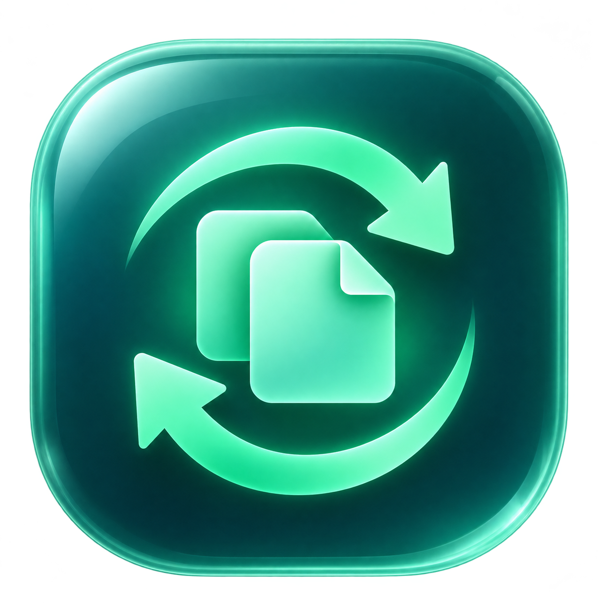

# QuickConvrt

QuickConvrt converts documents and images locally. Pick a file, choose a format from the wheel, and save the result to a folder you choose. The Mac utility lives in the menu bar. The React Native Windows source preview runs in a desktop window.

## Install on macOS

QuickConvrt is free to download and use. It targets **Apple Silicon Macs (M1 or newer) running macOS 13 or later**. To check your Mac, choose **Apple menu → About This Mac** and look for an Apple chip and the macOS version.

**[Download the Mac preview ZIP](https://github.com/Nihalrt/Docenlume/releases/download/v0.4.15-preview/QuickConvrt-Mac-arm64-v0.4.15-DEV.zip).** Apple has not notarized this preview, so macOS may block it on first launch. You can also [build the app from source](mac-utility/README.md#build-and-install-locally).

1. In Finder, open **Downloads** and double-click the ZIP if your browser has not already extracted it.
2. Drag **QuickConvrt.app** into **Applications** and open it from there.
3. Click the **QuickConvrt** icon in the menu bar or press **Control–Option–Command–E**. Add a file, choose an output format and save folder, then click **Convert**.

The app includes its conversion engines. You can use it without a QuickConvrt account, subscription, or separate Word, LibreOffice, or Python installation.

## Build on Windows

See [Build and run on Windows x64](windows-app/README.md#build-and-run-on-windows-x64) for the React Native source preview and its local conversion engine.

## Use QuickConvrt on macOS

1. Click the QuickConvrt menu bar icon or press **Control–Option–Command–E**.
2. Click **Add files**, drop files onto the widget, or paste files copied in Finder.
3. Hover over a format to preview it, then click to select it. Choose a **Save to** folder and click **Convert**.

Choose **Compress → Reduce file size** to save a smaller PDF, JPEG, or PNG with its original filename. **Create ZIP** bundles selected files of any type into one archive. Both compression modes accept files over 100 MB. If the output filename is already in use, QuickConvrt saves it in a new subfolder.

You can also select files in Finder and choose **Services → Convert with QuickConvrt**. If macOS blocks access to a file, use **Choose Files and Retry** to select it in the system picker.

QuickConvrt supports PDF, Word, plain text, and common image formats. See [supported conversions and limits](mac-utility/README.md#supported-routes-and-limits) for details. The [release checklist](RELEASING.md) covers packaging and publication.

## License

QuickConvrt's own source is available under the [GNU Affero General Public License, version 3](LICENSE). Third-party components keep their original licenses. See [third-party sources and notices](THIRD-PARTY.md).
